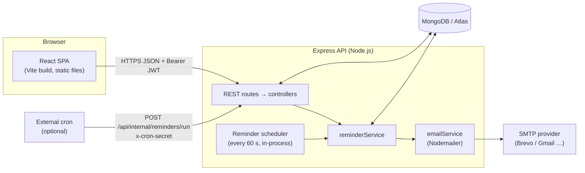
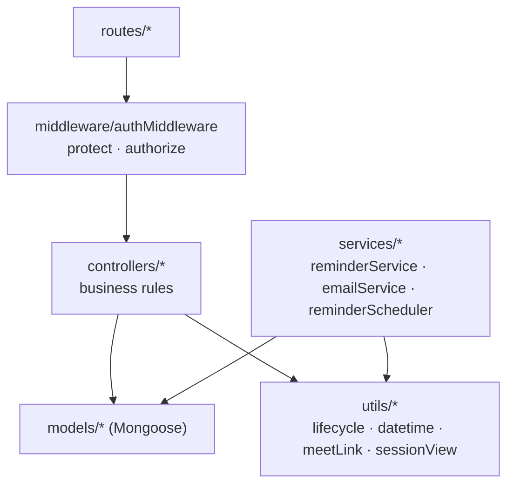
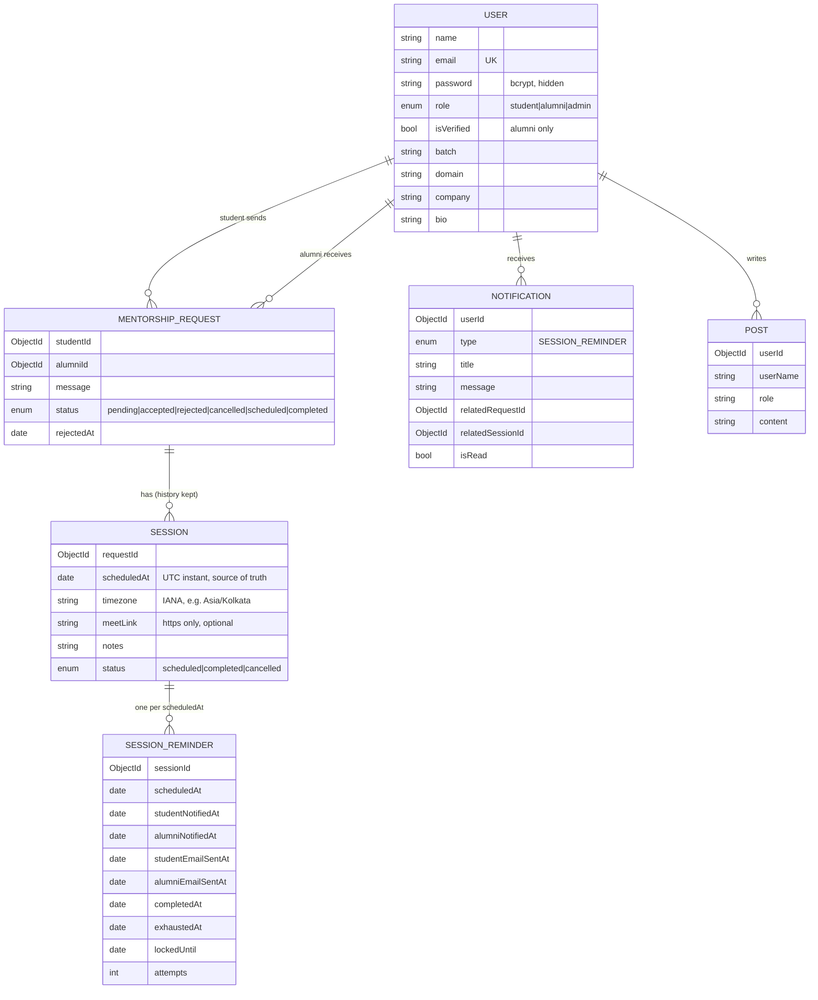
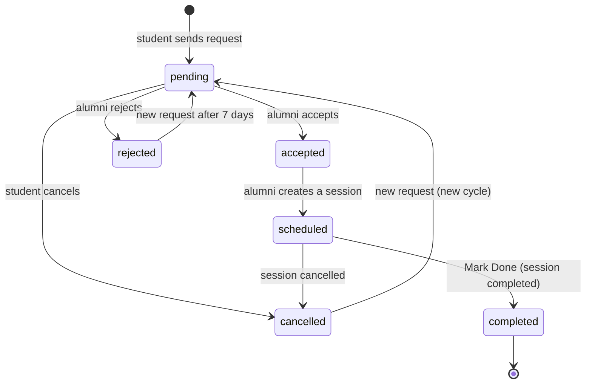
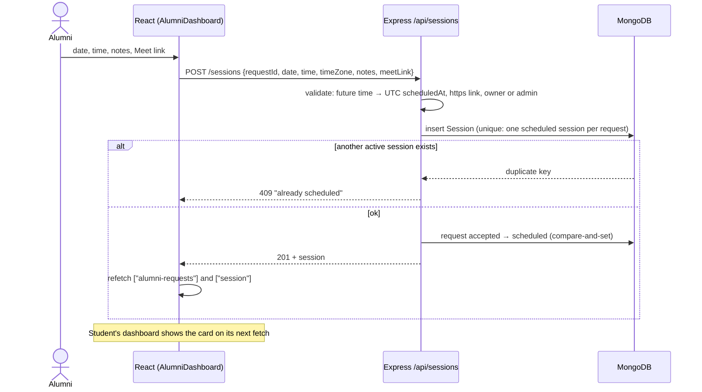
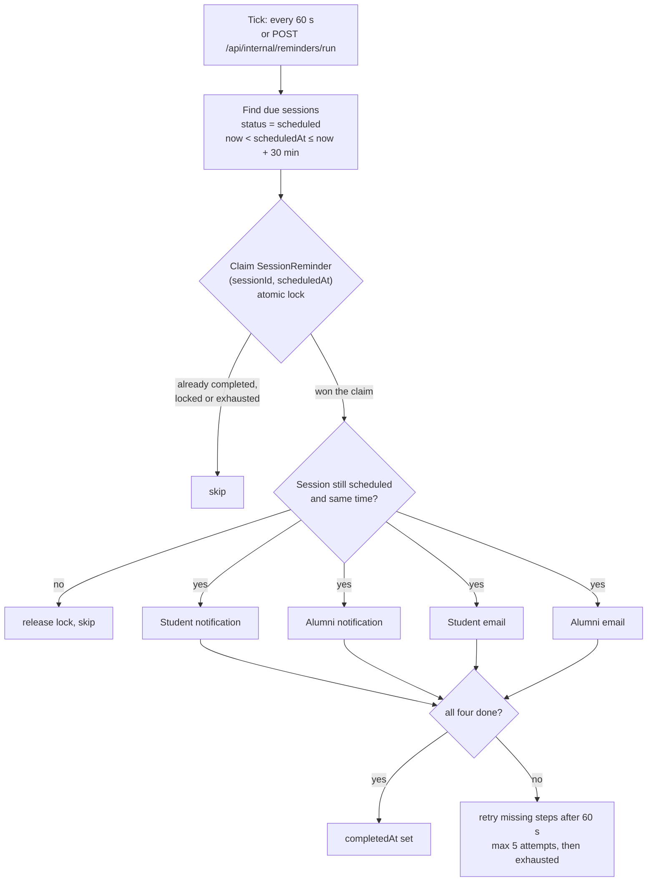
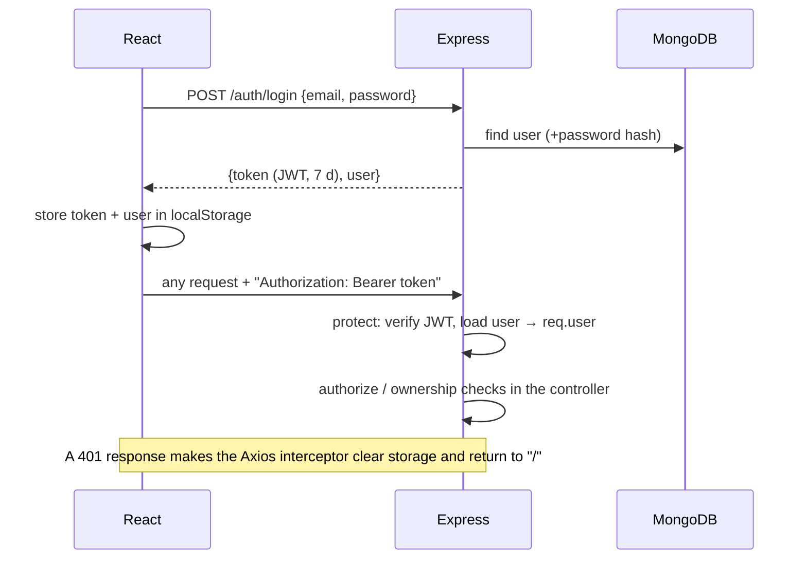
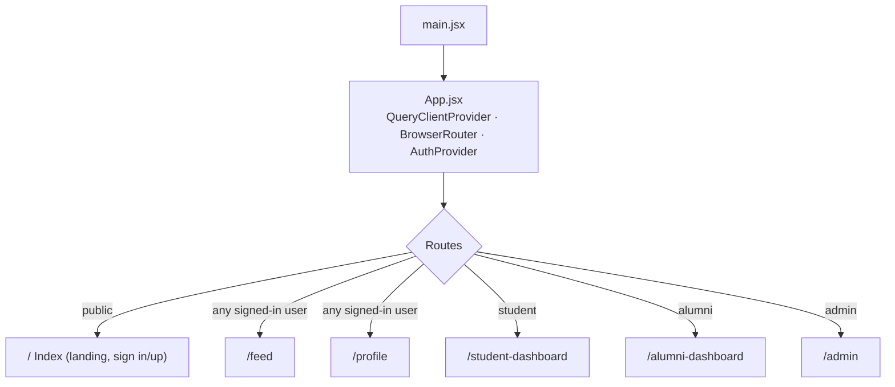
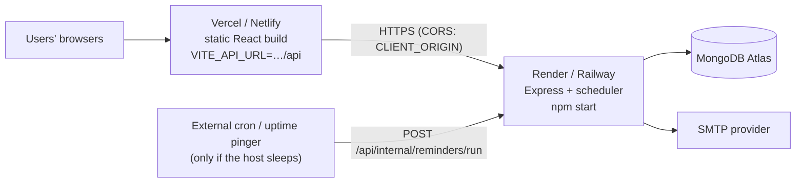

# SaarthiX — Architecture

This document describes how SaarthiX is built and how data flows through it. Everything here reflects the code in this repository. Diagrams use [Mermaid](https://mermaid.js.org/) (rendered automatically on GitHub).

**Contents**
1. [System overview](#1-system-overview)
2. [Backend structure](#2-backend-structure)
3. [Data model](#3-data-model)
4. [Mentorship request & session lifecycle](#4-mentorship-request--session-lifecycle)
5. [Scheduling a session (end to end)](#5-scheduling-a-session-end-to-end)
6. [Reminder pipeline](#6-reminder-pipeline)
7. [Authentication & authorization](#7-authentication--authorization)
8. [Frontend architecture](#8-frontend-architecture)
9. [Time handling](#9-time-handling)
10. [Security controls](#10-security-controls)
11. [Deployment architecture](#11-deployment-architecture)
12. [Design decisions](#12-design-decisions)

---

## 1. System overview

- The **frontend** is a static single-page app. It only talks to the API over HTTPS.
- The **backend** is one Express process. It serves the REST API **and** runs the reminder scheduler.
- **MongoDB is the single source of truth.** Nothing about reminders or sessions is kept only in memory, so restarts lose nothing.
- Email goes out through plain SMTP; the provider can be swapped by changing environment variables.

---

## 2. Backend structure

Request path: **route → middleware → controller → model**. Logic that isn't a request handler lives in `services/` and `utils/`.

| Path | Responsibility |
|---|---|
| `server.js` | Entry point: checks `JWT_SECRET`, connects to MongoDB, starts HTTP server, starts the reminder scheduler |
| `app.js` | Helmet, CORS, rate limit (auth only), JSON parsing, route mounting, 404 + global error handler |
| `middleware/authMiddleware.js` | `protect` verifies the JWT and loads the user; `authorize(...roles)` checks the role |
| `controllers/authController.js` | Register (student/alumni only), login, current user, profile update (whitelisted fields) |
| `controllers/mentorshipController.js` | Alumni directory, send/re-send request (cooldown), request lists (with their session attached), status changes |
| `controllers/sessionController.js` | Schedule session, read session, complete/cancel session |
| `controllers/notificationController.js` | List / mark read / mark all read — always scoped to `req.user` |
| `controllers/adminController.js` | Users list, stats, verify alumni, delete user with cascade |
| `controllers/postController.js` | Community feed |
| `utils/lifecycle.js` | The state-transition tables and `closeSession()` (atomic, keeps request and session in sync) |
| `utils/datetime.js` | Converts "date + time + time zone" to a UTC instant (built-in `Intl`, no extra library) |
| `utils/meetLink.js` | Accepts only valid `https://` links |
| `utils/sessionView.js` | Shapes sessions for API responses and attaches them to request lists in one query |
| `services/emailService.js` | SMTP transport + email templates (HTML escaped); offline transport in tests |
| `services/reminderService.js` | Finds due sessions, claims the reminder, performs the four delivery steps, retries |
| `services/reminderScheduler.js` | `setInterval` (60 s) that calls the reminder service, plus a catch-up run at boot |
| `routes/internalRoutes.js` | Optional HTTP trigger for the reminder pass (secret header, off by default) |

---

## 3. Data model

**Constraints that carry business rules**

| Collection | Index / constraint | Purpose |
|---|---|---|
| `users` | unique `email` | One account per email |
| `mentorshiprequests` | unique `(studentId, alumniId)` | One request document per pair (re-requests reuse it) |
| `sessions` | partial unique `(requestId, status)` where `status = "scheduled"` | **At most one active session per request**; cancelled/completed sessions stay as history |
| `sessions` | `(status, scheduledAt)` | Fast "what is due soon" query for reminders |
| `sessionreminders` | unique `(sessionId, scheduledAt)` | **One reminder per session time** — the duplicate guard; a new time means a new reminder |
| `notifications` | `(userId, createdAt)`, `(userId, isRead, createdAt)` | Listing and unread counts |
| `notifications` | partial unique `(userId, dedupeKey)` | Database-level backstop against duplicate reminder notifications |

---

## 4. Mentorship request & session lifecycle

The server owns the state machine (`server/utils/lifecycle.js`). The UI only hides buttons — it is never the security boundary.

Session: `scheduled → completed` or `scheduled → cancelled`. Both end states are final.

| Transition | Triggered by | Endpoint |
|---|---|---|
| → `pending` | Student | `POST /mentorship/request` (cooldown applies after a rejection) |
| `pending →` `accepted` / `rejected` | Owner alumni, admin | `PATCH /mentorship/:id/status` |
| `pending →` `cancelled` | Owning student | `PATCH /mentorship/:id/status` |
| `accepted → scheduled` | Owner alumni, admin — **only by creating a session** | `POST /sessions` |
| `scheduled → completed` | Owner alumni, admin | `PATCH /mentorship/:id/status` (the "Mark Done" button) or `PATCH /sessions/:id/status` |
| `scheduled → cancelled` | Owner alumni, admin | `PATCH /sessions/:id/status` |

Anything else is rejected with **409**; the wrong person gets **403**.

**Keeping request and session consistent (no transactions).** MongoDB transactions need a replica set, which a default local `mongod` isn't. Instead:

1. Every change is a **compare-and-set** (`findOneAndUpdate` filtered on the expected current status), so two simultaneous calls can't both succeed.
2. **Scheduling:** create the session first (the partial unique index blocks a second active one → clean `409`), then move the request `accepted → scheduled`. If that second step fails, the just-created session is deleted again.
3. **Completing / cancelling:** `closeSession()` updates the session, then the request. If the request update fails (inconsistent legacy data) the session change is rolled back.

**Re-request after a cancelled session.** The same request document is reopened (`cancelled → pending`). The old cancelled session stays as history and does not block the new one, because the unique index only covers sessions that are `scheduled`.

---

## 5. Scheduling a session (end to end)

What the dashboards get back: `GET /mentorship/student` and `GET /mentorship/alumni` attach a `session` object (`id, scheduledAt, timezone, meetLink, notes, status`) to each request that is `scheduled` or `completed`, using **one batched query** (no N+1). The card shows date/time and **Join Meet** only when the request **and** its session are `scheduled` and the link is a safe `https://` URL. Old rows with an unsafe stored link never receive it.

---

## 6. Reminder pipeline

**Rules**

| Situation | Behaviour |
|---|---|
| Exactly 30 min before | Eligible (`scheduledAt ≤ now + 30 min`) |
| More than 30 min before | Not yet eligible |
| Scheduled less than 30 min before start | Eligible immediately; message says the real minutes left |
| Already started | No reminder |
| Cancelled / completed / deleted | Never selected; also re-checked just before sending |
| Rescheduled (`scheduledAt` changed) | New key `(sessionId, scheduledAt)` → a fresh reminder; the old one can never fire |
| Server restart / sleep | The next tick (and a catch-up tick at boot) picks up whatever is due |

**How duplicates are prevented**

1. The `SessionReminder` record is created idempotently; its **unique `(sessionId, scheduledAt)`** key means there is only ever one per session time.
2. A processor must **claim** it with one atomic `findOneAndUpdate` (sets `lockedUntil`, increments `attempts`). Concurrent ticks or server instances lose the claim and skip.
3. Each of the four steps has its own timestamp, written right after that step succeeds. A retry only repeats missing steps — nobody gets a second email because the other person's email failed.
4. Notifications also carry a unique `dedupeKey`, so even a lost flag cannot create a second notification.
5. A crashed processor's lock expires after 5 minutes so another run can finish the job.

Email is *at least once*: a crash exactly between "SMTP accepted" and "flag saved" could resend one email. That window is tiny and cannot be removed with any SMTP setup.

**Failure handling.** A missing or invalid email address, or an SMTP error, fails only that step. Errors are logged without credentials (`[Reminder] …`) and a short error text is stored on the record.

**Notifications in the UI.** `NotificationBell` loads `GET /notifications` with React Query (`["notifications"]`), refetches once a minute and on window focus, shows the unread badge, marks items read on click and opens the user's dashboard. There are no browser timers involved in sending reminders.

---

## 7. Authentication & authorization

| Role | Can |
|---|---|
| `student` | Browse alumni, send/cancel own requests, read own sessions, feed, profile, own notifications |
| `alumni` | Accept/reject requests addressed to them, schedule/complete/cancel their sessions, feed, profile, own notifications. Must be **verified** to be requestable |
| `admin` | Verify alumni, delete users, view stats; may act on any session/request where the code allows admin |

Ownership is always checked **on the server** (e.g. a student can only cancel their own pending request; a user can only mark their own notification as read — someone else's returns `404`).

---

## 8. Frontend architecture

- **Navbar:** each page renders `<Navbar />` itself; it contains the `NotificationBell` (desktop and mobile) and the sign-in / sign-up dialogs. Toasts come from `sonner`.
- **Route guards:** `PublicRoute` sends signed-in users to `/feed`; `ProtectedRoute` sends signed-out users to `/` and redirects a wrong role to its own dashboard. These guards are convenience — the API enforces access.
- **State:** `AuthContext` holds the user and token. Server data lives in **React Query**: `["student-requests"]`, `["alumni-requests"]`, `["alumni-list", search, domain]`, `["session", requestId]`, `["notifications"]`, `["admin-users"]`, `["admin-stats"]`. Defaults: 1-minute stale time, one retry.
- **API layer:** `services/api.js` has one Axios instance (adds the Bearer token, handles 401) and grouped helpers: `authAPI`, `mentorshipAPI`, `sessionAPI`, `notificationAPI`, `adminAPI`, `postsAPI`.
- **Shared UI pieces:** `SessionInfo` (scheduled date/time + Join Meet; used by both dashboards), `StatusBadge`, `NotificationBell`, `Loader`.
- **Pure logic, unit-tested:** `utils/sessionView.js` (when to show the Meet button, date/time formatting) and `utils/notificationView.js` (badge text, "x min ago", click target) have no imports and are covered by `node:test` in `client/tests`.

---

## 9. Time handling

- A session time is stored as **one UTC instant** (`Session.scheduledAt`, a MongoDB `Date`). Reminder timing, sorting and "is it in the future" all use it. Separate date/time strings are no longer written (old rows keep them, and the API derives `scheduledAt` for them).
- The scheduling form sends `date`, `time` and the browser's IANA `timeZone`. The server converts them to UTC with `Intl`; the default zone (when none is sent) is `APP_TIMEZONE` = `Asia/Kolkata`. Nothing depends on the server's own time zone, and other zones work without code changes.
- A `scheduledAt` without an offset is rejected as ambiguous; times in the past are rejected.
- **Display:** the web app shows times in the viewer's local zone; emails show the time in the session's stored zone (IST for India).

---

## 10. Security controls

| Area | Control |
|---|---|
| Passwords | bcrypt (12 rounds); `select: false`, never returned |
| Auth | JWT (default 7 days); `protect` on every private route |
| Authorization | `authorize` for roles + ownership checks in controllers |
| Input | Type checks on every body field (blocks NoSQL operator injection), escaped regex search, field whitelists, 10 KB body limit |
| Transport / headers | Helmet; CORS restricted to `CLIENT_ORIGIN` in production |
| Abuse | Rate limit on `/api/auth/*` (20 / 15 min / IP); `trust proxy` enabled in production so the real client IP is used |
| Links / XSS | Meet links must be `https://` (validated on the server, re-checked in the UI); email HTML is escaped |
| Notifications | Queries always include the signed-in user's id; foreign ids return 404 |
| Cron endpoint | Constant-time secret comparison; returns 404 unless `CRON_SECRET` is set |
| Secrets | Only in environment variables; `.env` files git-ignored; logs never include credentials |

---

## 11. Deployment architecture

- The frontend and backend are deployed separately. `VITE_API_URL` is baked into the frontend at build time; `CLIENT_ORIGIN` must match the frontend URL exactly.
- The scheduler lives inside the backend process. Hosts that put idle servers to sleep can't run a timer while asleep — use the external trigger (every minute). With several backend instances, everything is still safe: the database claim makes sure each reminder is processed once.
- Step-by-step instructions are in the [README](../README.md#deployment).

---

## 12. Design decisions

| Decision | Why |
|---|---|
| Plain `setInterval` + MongoDB as the source of truth, instead of per-session timeouts or a queue | Simplest design that survives restarts, crashes and multiple instances; no extra infrastructure for a portfolio-scale app |
| A separate `SessionReminder` collection (not a flag on `Session`) | Keyed by `(session, time)`: rescheduling re-arms it, per-step delivery state, history, and a unique index as the duplicate guard |
| Compare-and-set updates instead of MongoDB transactions | Works on standalone and Atlas alike; each step is atomic on a single document, with ordered writes and rollback for the two-document cases |
| Partial unique index on active sessions | Allows cancelled/completed history while guaranteeing a single active session per request, even under double clicks |
| Reuse the request document for a new mentorship cycle | Smallest change that keeps the existing UI/API; history lives in `Session` documents |
| `scheduledAt` as a UTC `Date` + IANA zone | Reliable arithmetic (`scheduledAt − 30 min`), correct display for any zone |
| Polling for notifications (no WebSockets) | Enough for a once-a-minute reminder feature; far less moving parts |
| State machine on the server, UI only mirrors it | The browser can never be the security boundary |
